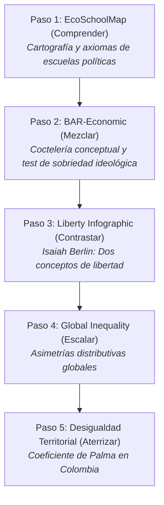
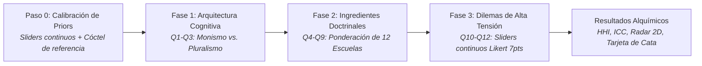

# Elixires de la Razón: El Bar Económico
### *Elixirs of Reason: The Economic Bar*

*Simulador cognitivo, taxonomía epistemológica y coctelería conceptual interactiva.*  
*An interactive cognitive simulator, epistemological taxonomy, and intellectual mixology experience.*

---

[](https://willkwolf.github.io/economic-bar/)
[](https://github.com/willkwolf/economic-bar)
[](https://creativecommons.org/licenses/by-sa/4.0/)
[](https://developer.mozilla.org/)
[](tests/e2e/diagnostic-flow.spec.js)
[-informational?style=flat-square)](data.js)
[](docs/)

---

## Overview (English)

**Elixires de la Razón: El Bar Económico** (*Elixirs of Reason: The Economic Bar*) is an open-source, interactive web application, epistemological taxonomy, and academic essay simulator that translates schools of economic and political thought into liquors, cocktail ingredients, and systemic remedies.

Drawing upon the qualitative pluralism of **Ha-Joon Chang** (*Economics: The User's Guide*, 2014) and the epistemological divide between the Hedgehog and the Fox articulated by **Isaiah Berlin** (*The Hedgehog and the Fox*, 1953; *Two Concepts of Liberty*, 1958), the project allows citizens, researchers, and students to explore economic doctrines through four interactive modules:

1. **The Apothecary Shelf (12 Reactive Bottles):** Pure doctrinal essences quantified across four dimensions: Ideological Alcohol by Volume (ABV), Public Intervention Acidity (pH), Organoleptic Flavor Profiles, and Systemic Collateral Toxicity.
2. **The Cocktail Menu (8 Doctrinal Blends):** Historical policy recipes modeled on an interactive canvas with fluid particle dynamics (e.g., *Nordic Social Democracy*, *Dialectical Hammer*, *Silicon Valley Sour*, *Asian Tiger Brew*).
3. **The Diagnostic Engine (Sobriety Test):** A 12-item psychometric journey structured into Bayesian Prior Calibration (P0), Cognitive Architecture (Q1–Q3), Doctrinal Weighting (Q4–Q9), and High-Tension Likert Dilemmas (Q10–Q12).
4. **Alchemical Analytics Engine:** Vectorial computation client-side featuring the Herfindahl-Hirschman Concentration Index ($HHI$), the Cognitive Consistency Index ($ICC$), and 2D Polar Vector projection across State, Market, Equity, and Growth axes.

The application features full end-to-end bilingual internationalization (English and Spanish) across all screens, questions, interactive tooltips, downloadable academic tasting certificates, and social sharing workflows.

---

## Resumen Ejecutivo (Español)

**Elixires de la Razón: El Bar Económico** es una aplicación web interactiva de divulgación cívica y rigor académico que concibe la economía política no como una ciencia monotemática e incontestable, sino como un mosaico de tradiciones pluralistas en tensión dialéctica.

Mediante la metáfora de un bar de coctelería alquímica (*Carbon Speakeasy*), el simulador desafía al usuario a reflexionar sobre sus propios sesgos cognitivos:
* ¿Piensa usted como un **Erizo** (buscando una única ley universal que explique todo) o como un **Zorro** (reconociendo equilibrios contextuales y compensaciones irreductibles)?
* ¿Hasta qué punto sus decisiones prácticas ante dilemas de desempleo, inflación o crisis ecológica coinciden con la ideología que afirma profesar?

El artefacto incluye una rigurosa suite de pruebas automatizadas con Playwright, modo de alta densidad de datos (Tufte mode), y una estructura documental exhaustiva y estandarizada bajo el directorio [`/docs`](docs/).

---

## Demo en Vivo / Live Access

* **Página Web Pública (GitHub Pages):** [https://willkwolf.github.io/economic-bar/](https://willkwolf.github.io/economic-bar/)
* **Repositorio de Código Fuente:** [https://github.com/willkwolf/economic-bar](https://github.com/willkwolf/economic-bar)

---

## La Ruta del Pensamiento Crítico (Ecosistema Educativo)

Este proyecto constituye el **Paso 2** de la serie pedagógica de cinco aplicaciones interactivas desarrolladas por William Camilo Artunduaga (`@willkwolf`):



1. **Paso 1 (Comprender):** Cartografía conceptual de las escuelas de pensamiento y sus axiomas.
2. **Paso 2 (Mezclar - Este repositorio):** Coctelería conceptual, tensiones institucionales y autodiagnóstico de consistencia ideológica.
3. **Paso 3 (Contrastar):** Confrontación ética entre libertad positiva y libertad negativa según Isaiah Berlin.
4. **Paso 4 (Escalar):** Brechas distributivas globales y acumulación de riqueza.
5. **Paso 5 (Aterrizar):** Impacto socioeconómico y coeficiente de Palma en el contexto territorial.

---

## Arquitectura del Diagnóstico Cognitivo (Test de Sobriedad)



### 1. Paso 0: Calibración Bayesiana de Priors
Antes de responder el cuestionario, el usuario declara sus intuiciones iniciales a través de dos controles continuos (Gobernanza: Estado vs Mercado; Propósito: Equidad vs Crecimiento) y selecciona un cóctel de referencia.

### 2. Fase 1: Arquitectura Cognitiva (Q1 a Q3)
Evalúa el temperamento epistemológico: monismo (un principio universal) vs. pluralismo (múltiples explicaciones contingentes).

### 3. Fase 2: Ingredientes Doctrinales (Q4 a Q9)
Confronta seis dilemas de política pública (distribución de renta, inflación, deuda soberana, cuidados, comercio exterior e innovación tecnológica) con opciones equilibradas y conservación de masa probabilística.

### 4. Fase 3: Dilemas de Alta Tensión (Q10 a Q12)
Trade-offs irreductibles evaluados mediante deslizadores con escala de diferencial semántico Likert de 7 puntos y lecturas cualitativas en tiempo real con porcentajes continuos.

---

## Modelado Matemático y Métricas Vectoriales

### 1. Índice de Herfindahl-Hirschman (HHI)
Mide la concentración dogmática de la fórmula resultante:

$$HHI = \sum_{i=1}^{12} (s_i)^2$$

* **$HHI > 2500$ (Monocultura Doctrinal):** Alta concentración y vulnerabilidad a sesgos de confirmación.
* **$1500 \le HHI \le 2500$ (Fórmula Equilibrada):** Hibridación sintetizadora y criterio multidisciplinar.
* **$HHI < 1500$ (Dispersión Ecléctica):** Riesgo de incoherencia o eclecticismo desarticulado.

### 2. Índice de Consistencia Cognitiva (ICC)
Mide la consecuencia intelectual comparando vectorialmente los priors declarados en el Paso 0 con las elecciones reveladas:

$$ICC = 0.60 \times \text{Similitud}_{\text{Coseno}} + 0.40 \times \text{Similitud}_{\text{Ejes}}$$

Donde $\text{Similitud}_{\text{Coseno}}$ evalúa la distancia angular entre la receta del cóctel inicial y los pesos resultantes, y $\text{Similitud}_{\text{Ejes}}$ mide la distancia euclidiana en el espacio unitario $[0, 1] \times [0, 1]$.

### 3. Visualización Polar 2D (HTML5 Canvas)
Renderizado matemático adaptativo del gráfico de radar que proyecta las fuerzas sobre cuatro ejes: Equidad ($0^\circ$), Crecimiento ($180^\circ$), Mercado ($90^\circ$) y Estado ($270^\circ$).

---

## Corpus Documental Canónico (`/docs`)

Inspirado en la estructura de [isaiah-berlin-liberty-infographic](https://github.com/willkwolf/isaiah-berlin-liberty-infographic), la documentación canónica está organizada de forma exhaustiva bajo [`/docs`](docs/):

| Módulo Documental | Enlace Canónico | Descripción Temática |
| :--- | :--- | :--- |
| **Portal Maestro** | [`docs/README.md`](docs/README.md) | Índice central y mapa de navegación del corpus documental. |
| **Marco Epistemológico** | [`docs/conceptual/epistemological_framework.md`](docs/conceptual/epistemological_framework.md) | Ensayo sobre Ha-Joon Chang, Isaiah Berlin y la alquimia conceptual. |
| **Taxonomía Doctrinal** | [`docs/conceptual/taxonomy_economic_schools.md`](docs/conceptual/taxonomy_economic_schools.md) | Fichas analíticas completas de las 12 escuelas (ABV, pH, toxicidad). |
| **Cócteles Doctrinales** | [`docs/conceptual/cocktail_doctrinal_blends.md`](docs/conceptual/cocktail_doctrinal_blends.md) | Fórmulas de las 8 recetas de política pública y crisis de gabinete. |
| **Diagnóstico Cognitivo** | [`docs/conceptual/cognitive_diagnostics.md`](docs/conceptual/cognitive_diagnostics.md) | Metodología del test de sobriedad, erizos, zorros y cuadrantes. |
| **Contratos de Datos** | [`docs/data/data_contracts.md`](docs/data/data_contracts.md) | Esquemas formales de datos e invariantes estructurales de `data.js`. |
| **Modelado Matemático** | [`docs/data/mathematical_models.md`](docs/data/mathematical_models.md) | Deducciones y formulación formal de HHI, ICC, Canvas 2D y Likert. |
| **Gobernanza i18n** | [`docs/data/i18n_governance.md`](docs/data/i18n_governance.md) | Política de paridad semántica dual (ES/EN) y cero fugas. |
| **Gobierno del Sitio** | [`docs/governance/website_governance_contracts.md`](docs/governance/website_governance_contracts.md) | Constitución editorial, mitigación de sesgos y compuertas de calidad. |
| **Reglas para Agentes** | [`docs/governance/agent_rules.md`](docs/governance/agent_rules.md) | Manual de operación para OpenWiki, Claude, Antigravity y Cursor. |
| **OpenWiki Context** | [`openwiki/INSTRUCTIONS.md`](openwiki/INSTRUCTIONS.md) | Instrucciones y hechos fundamentados para agentes inteligentes. |

---

## Suite de Pruebas y Aseguramiento de Calidad

El proyecto dispone de una infraestructura de pruebas automatizadas que garantiza cero regresiones:

```bash
# Ejecutar las 12 pruebas E2E con Playwright
npm test
```

### Cobertura de la Suite E2E:
1. Flujo completo de 12 preguntas de onboarding a resultados alquímicos.
2. Reactividad dinámica de sliders de onboarding y actualización de descripciones.
3. Reinicio limpio del test y restauración a estado inicial.
4. **Navegación bidireccional (Atrás/Adelante) con modificación de respuestas y persistencia de selección.**
5. **Validación de lecturas de slider en Fase 3 con porcentajes cualitativos.**
6. **Recorrido completo en idioma inglés de punta a punta con aserción de cero fugas en español.**
7. Pruebas cruzadas en navegadores de escritorio (Desktop Chromium) y móviles (Pixel 5).

---

## Stack Tecnológico

El proyecto se rige por una arquitectura estricta sin dependencias de compilación externa:
* **HTML5 Semántico:** Estructura accesible offline con roles WAI-ARIA, etiquetas dinámicas y compatibilidad con lectores de pantalla.
* **CSS3 Moderno:** Glassmorphism, variables CSS dinámicas, tipografía fluida y soporte para modo Tufte (alta densidad de datos) y modo de Alto Contraste.
* **Vanilla JavaScript (ES6+):** Programación funcional pura, cero frameworks de frontend y cálculo vectorial en cliente.
* **HTML5 Canvas 2D:** Renderizado matemático del gráfico de radar y cálculo adaptativo de densidad de píxeles (DPR).
* **Playwright Test Runner:** Automatización de pruebas de integración continua y compatibilidad cross-browser.
* **OpenWiki CLI:** Infraestructura documental para agentes inteligentes.

---

## Instalación y Ejecución Local

Al ser una aplicación web estática autoportante, no requiere herramientas de construcción complejas:

```bash
# 1. Clonar el repositorio
git clone https://github.com/willkwolf/economic-bar.git
cd economic-bar

# 2. Servir localmente con cualquier servidor estático
python -m http.server 3000
# o alternativamente:
# npx live-server
```

Para ejecutar las pruebas automatizadas:
```bash
# Instalar dependencias
npm install

# Correr las pruebas
npm test
```

---

## Cómo Citar / Academic Citation

### Formato APA (7ma Edición)
> Artunduaga Viana, W. C. (2026). *Elixires de la Razón: El Bar de Escuelas Económicas e Hibridación de Coctelería Conceptual* [Software interactivo]. GitHub. https://github.com/willkwolf/economic-bar

### Formato BibTeX
```bibtex
@software{artunduaga2026bar,
  author = {Artunduaga Viana, William Camilo},
  title = {Elixires de la Razon: El Bar de Escuelas Economicas},
  year = {2026},
  publisher = {GitHub},
  url = {https://github.com/willkwolf/economic-bar},
  note = {Simulador interactivo de cocteleria ideologica basado en Ha-Joon Chang e Isaiah Berlin}
}
```

---

## Licencia

Este trabajo se publica bajo los términos de la licencia internacional **Creative Commons Atribución-CompartirIgual 4.0 (CC BY-SA 4.0)**.

Usted es libre de compartir, copiar, distribuir y adaptar el material para cualquier propósito, incluso comercial, siempre que reconozca adecuadamente la autoría original y distribuya las obras derivadas bajo la misma licencia.
