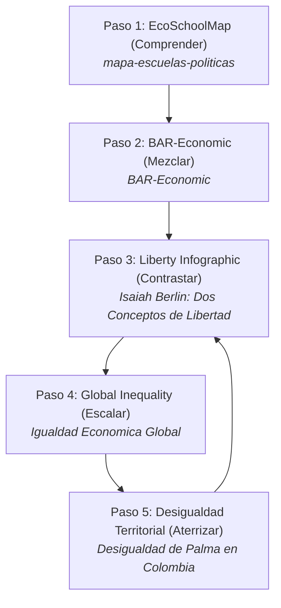
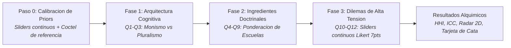

# Elixires de la Razon: El Bar Economico

*Simulador cognitivo, taxonomía epistemológica y coctelería conceptual interactiva.*  
*An interactive cognitive simulator, epistemological taxonomy, and intellectual mixology experience.*

---

[](https://willkwolf.github.io/economic-bar/)
[](https://github.com/willkwolf/economic-bar)
[](https://creativecommons.org/licenses/by-sa/4.0/)
[](https://developer.mozilla.org/)
[](tests/e2e/diagnostic-flow.spec.js)
[-informational?style=flat-square)](data.js)

---

## Overview (English)

**Elixires de la Razon: El Bar Economico** (Elixirs of Reason: The Economic Bar) is an open-source, interactive web application and pedagogical simulator that translates schools of economic, political, and philosophical thought into liquors, cocktail ingredients, and systemic remedies.

Drawing upon the qualitative taxonomy of **Ha-Joon Chang** (*Economics: The User's Guide*, 2014) and the epistemological divide between the Hedgehog and the Fox articulated by **Isaiah Berlin** (*The Hedgehog and the Fox*, 1953), the project lets users explore economic doctrines through three interactive modules:
1. **The Apothecary Shelf (12 Reactive Bottles):** Pure doctrinal essences characterized by Ideological Alcohol by Volume (ABV), organoleptic flavor profiles, public intervention pH, and systemic collateral toxicity.
2. **The Cocktail Menu (8 Doctrinal Blends):** Historical policy recipes modeled on an interactive canvas with fluid particle dynamics (e.g., *Nordic Social Democracy*, *Dialectical Hammer*, *Silicon Valley Sour*).
3. **The Diagnostic Engine (Sobriety Test):** A 12-item psychometric journey that measures cognitive consistency, doctrinal concentration via the Herfindahl-Hirschman Index ($HHI$), and cognitive coherence ($ICC$) between stated ideological priors and revealed policy choices.

The application features full end-to-end bilingual internationalization (English and Spanish) across all screens, questions, interactive tooltips, downloadable academic tasting certificates, and social sharing workflows.

---

## Demo en Vivo / Live Demo

* Acceso web público: [https://willkwolf.github.io/economic-bar/](https://willkwolf.github.io/economic-bar/)
* Repositorio oficial de código: [https://github.com/willkwolf/economic-bar](https://github.com/willkwolf/economic-bar)

---

## La Ruta del Pensamiento Critico (Ecosistema Educativo)

Este proyecto constituye el **Paso 2** de la serie de cinco aplicaciones educativas interactivas desarrolladas por `@willkwolf`, diseñadas para fomentar la alfabetización económica, el análisis ético y la reflexión sobre políticas públicas:



* **Paso 1 (Comprender):** Cartografía conceptual de las escuelas de pensamiento y sus axiomas.
* **Paso 2 (Mezclar - Este repositorio):** Coctelería conceptual, tensiones institucionales y autodiagnóstico de consistencia ideológica.
* **Paso 3 (Contrastar):** Confrontación ética entre libertad positiva y libertad negativa según Isaiah Berlin.
* **Paso 4 (Escalar):** Brechas distributivas globales y acumulación de riqueza.
* **Paso 5 (Aterrizar):** Impacto socioeconómico y coeficiente de Palma en el contexto territorial.

---

## Marco Epistemologico y Pedagogico

### 1. Taxonomia de Ha-Joon Chang (Las 12 Doctrinas)
En lugar de presentar la teoría económica como una ciencia unificada e incontestable, el Bar Económico adopta la tesis metodológica de Chang: la economía es un mosaico de tradiciones analíticas con supuestos antropológicos y metas normativas divergentes. Cada escuela se modela con cuatro dimensiones cuantitativas y cualitativas:
* **ABV Ideologico (Graduacion Doctrinal):** Nivel de rigidez dogmática y pureza metodológica.
* **Notas Organolepticas:** Metáforas sensoriales que capturan su visión del mundo (ej. Neoclásica: destilada, aséptica y con notas de optimismo de mercado; Marxista: terrosa, amarga y cargada de tensión distributiva).
* **pH Estatal (Acidez Reguladora):** Grado de intervención pública requerida en la economía (desde pH 1.0 fuertemente ácido/intervencionista hasta pH 14.0 alcalino/laissez-faire).
* **Toxicidad Colateral:** Externalidades sistémicas y distorsiones provocadas por su aplicación dogmática (inflación, hipertrofia burocrática, monopolios crónicos o colapso de demanda agregada).

### 2. El Dilema de Berlin: Erizos y Zorros
Basado en el ensayo canónico de Isaiah Berlin sobre Arquíloco, el motor clasifica el razonamiento del usuario en cuatro arquetipos cognitivos:
* **Monismo Doctrinal (Erizo Doctrinal):** Convencimiento de que un único marco teórico explica todas las facetas económicas.
* **Pluralismo Sistemico (Zorro Sistemico):** Capacidad de transitar coherentemente entre diferentes marcos analíticos dependiendo del contexto y la naturaleza del problema.
* **Monismo Eclectico (Erizo Hibrido):** Adopción de premisas múltiples que convergen en una regla de decisión uniforme.
* **Pluralismo Pragmatico (Zorro Operativo):** Orientación inductiva guiada por resultados contingentes sobre dogmas teóricos.

---

## Arquitectura del Motor de Diagnostico (Test de Sobriedad)

El autodiagnóstico consta de una progresión metodológica en cuatro etapas con validación psicométrica:



### Paso 0: Calibracion Bayesiana de Priors (Onboarding)
Antes de responder el cuestionario, el usuario declara sus intuiciones iniciales a través de dos controles continuos (Gobernanza: Estado vs Mercado; Propósito: Equidad vs Crecimiento) y selecciona un cóctel de referencia. Estos datos alimentan el contraste de consistencia final.

### Fase 1: Arquitectura Cognitiva (Reactivos 1 a 3)
Evalúa si el usuario opera con sesgos monistas (una verdad universal) o pluralistas (múltiples explicaciones contingentes) ante crisis históricas y debates epistemológicos.

### Fase 2: Ingredientes Ideologicos (Reactivos 4 a 9)
Confronta problemas de política pública concreta (distribución de renta, inflación, deuda soberana, comercio exterior e innovación tecnológica) mediante cuatro opciones equilibradas con ponderación multidimensional de escuelas.

### Fase 3: Dilemas de Alta Tension (Reactivos 10 a 12)
Trade-offs irreductibles evaluados mediante sliders continuos con escala Likert de 7 puntos y lectura cualitativa en tiempo real con porcentaje:
* **Ejemplo de lectura:** `<span class="slider-value-display" id="slider-value-readout">Preferencia moderada por Gasto y Empleo (71%)</span>`

### Experiencia de Navegacion Bidireccional
* **Navegacion hacia atras:** Botones "Atras" integrados en cabecera y controles de slider que permiten revisar y modificar respuestas anteriores.
* **Retorno a calibracion:** Permite regresar desde la primera pregunta al panel de calibración de priors sin pérdida de estado.
* **Persistencia visual:** Las opciones seleccionadas previamente retienen su estado `.selected` y los sliders su posición exacta.
* **Transiciones direccionales:** Animaciones aceleradas por GPU (`anim-slide-in-right` al avanzar, `anim-slide-in-left` al retroceder).

---

## Metricas Estadisticas y Vectoriales

### 1. Indice de Herfindahl-Hirschman (HHI)
Mide la concentración dogmática de la fórmula resultante:

$$HHI = \sum_{i=1}^{n} (s_i)^2$$

*Donde $s_i$ representa el porcentaje de afinidad de la escuela económica $i$.*
* **HHI > 2500 (Monocultura Doctrinal):** Alta concentración y vulnerabilidad a sesgos de confirmación.
* **1500 <= HHI <= 2500 (Formula Equilibrada):** Hibridación sintetizadora y criterio multidisciplinar.
* **HHI < 1500 (Dispersión Ecléctica):** Riesgo de incoherencia o eclecticismo desarticulado.

### 2. Consistencia Cognitiva e Intraclase (ICC)
Compara vectorialmente las respuestas declaradas en el Paso 0 (priors) con las elecciones reveladas a lo largo de las Fases 1, 2 y 3. Produce una métrica porcentual de consecuencia intelectual que clasifica el perfil en coherencia alta, moderada o en tensión deductiva.

### 3. Visualizacion Multidimensional
* **Grafico de Radar 2D (HTML5 Canvas):** Representa las fuerzas vectoriales en cuatro ejes polares: Equidad, Mercado, Crecimiento y Estado.
* **Estratificacion Molecular en Botella:** Simulación de líquidos en capas con alturas proporcionales a las afinidades del usuario e inspección interactiva por hover.

---

## Internacionalizacion Completa (i18n)

El proyecto cuenta con un motor nativo de internacionalización en [data.js](data.js) y [app.js](app.js) que garantiza una experiencia 100% bilingüe (Español / Inglés) de extremo a extremo:
* **Conmutacion reactiva al vuelo:** Selector persistente en `localStorage` con atributos `data-i18n` y actualización sin recargar la página.
* **Cuestionario y dilemas traducidos:** Los 12 reactivos, opciones y dilemas de fase 3 se adaptan semánticamente a cada idioma.
* **Glosario epistemologico contextual:** Más de 60 términos económicos integrados en [data.js](data.js) con tooltips automáticos no intrusivos.
* **Reporte y certificacion de cata:** Pantalla de resultados, exportación en formato A4 académico (`exportTastingCard`) y mensajes virales de WhatsApp completamente localizados.

---

## Suite de Pruebas y Aseguramiento de Calidad

El proyecto dispone de una infraestructura de pruebas automatizadas que garantiza cero regresiones:

### 1. Pruebas End-to-End con Playwright
Suite integral en [tests/e2e/diagnostic-flow.spec.js](tests/e2e/diagnostic-flow.spec.js) ejecutada tanto en navegadores de escritorio (Desktop Chromium) como en dispositivos móviles (Mobile Chrome - Pixel 5):
* Flujo completo de 12 preguntas de onboarding a resultados alquímicos.
* Reactividad dinámica de sliders de onboarding y actualización de descripciones.
* Reinicio limpio del test y restauración a estado inicial.
* **Navegación bidireccional (Atrás/Adelante) con modificación de respuestas y persistencia de selección.**
* **Validación de lecturas de slider en Fase 3 con porcentajes cualitativos.**
* **Recorrido completo en idioma inglés de punta a punta con aserción de cero fugas en español.**

Para ejecutar las pruebas localmente:
```bash
npm test
```

### 2. Pruebas de Regresion Visual con Vibium
Línea base visual documentada en [tests/baseline/](tests/baseline/) con 12 capturas de referencia que cubren los estados críticos de la interfaz en escritorio y móvil.

### 3. Plan Kaizen y Auditoria Integral
* **Auditoría Integral:** Informe técnico de 770+ líneas en [docs/auditoria_integral.md](docs/auditoria_integral.md) con evaluación en tres ejes: Facilidad Lectora, Rigor Metodológico y Rendimiento Mobile/Accesibilidad.
* **Plan Kaizen:** Hoja de ruta en cuatro fases de mejora continua documentada en [docs/plan_kaizen.md](docs/plan_kaizen.md).

---

## Stack Tecnologico

El proyecto se rige por una arquitectura estricta sin dependencias de compilación externa:
* **HTML5 Semántico:** Estructura accesible offline con roles WAI-ARIA, etiquetas dinámicas y compatibilidad con lectores de pantalla.
* **CSS3 Moderno:** Glassmorphism, variables CSS dinámicas, tipografía fluida y soporte para modo Tufte (densidad de datos) y modo de Alto Contraste.
* **Vanilla JavaScript (ES6+):** Programación funcional pura, cero frameworks de frontend y cálculo vectorial en cliente.
* **HTML5 Canvas 2D:** Renderizado matemático del gráfico de radar y cálculo adaptativo de densidad de píxeles (DPR).
* **Playwright Test Runner:** Automatización de pruebas de integración continua y compatibilidad cross-browser.

---

## Instalacion y Ejecucion Local

Al ser una aplicación web estática autoportante, no requiere configuración compleja:

```bash
# 1. Clonar el repositorio
git clone https://github.com/willkwolf/economic-bar.git
cd economic-bar

# 2. Servir localmente con cualquier servidor estático
python -m http.server 3000
# o alternativamente:
# npx live-server
```

Para ejecutar la suite de pruebas automatizadas:
```bash
# Instalar dependencias de Playwright (solo si vas a correr tests)
npm install

# Ejecutar las 12 pruebas E2E
npm test
```

---

## Como Citar / Academic Citation

### Formato APA (7ma Edicion)
> Artunduaga Viana, W. C. (2026). *Elixires de la Razon: El Bar de Escuelas Economicas e Hibridacion de Cocteleria Conceptual* [Software interactivo]. GitHub. https://github.com/willkwolf/economic-bar

### Formato BibTeX
```bibtex
@software{artunduaga2026bar,
  author = {Artunduaga Viana, William Camilo},
  title = {Elixires de la Razon: El Bar de Escuelas Economicas},
  year = {2026},
  publisher = {GitHub},
  url = {https://github.com/willkwolf/economic-bar},
  note = {Simulador interactivo de cocteleria ideologica basado en Ha-Joon Chang e Isaiah Berlin}
}
```

---

## Licencia

Este trabajo se publica bajo los términos de la licencia internacional **Creative Commons Atribucion-CompartirIgual 4.0 (CC BY-SA 4.0)**.

Usted es libre de compartir, copiar, distribuir y adaptar el material para cualquier propósito, incluso comercial, siempre que reconozca adecuadamente la autoría original y distribuya las obras derivadas bajo la misma licencia.
