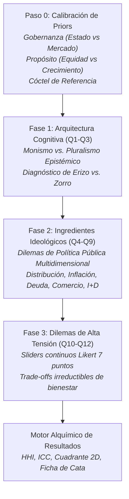

# Motor de Diagnóstico Cognitivo y Psicométrico
## El Test de Sobriedad Ideológica: Erizos, Zorros y Espacio Polar 2D

---

## 1. Arquitectura Metodológica del Diagnóstico

El autodiagnóstico del Bar Económico no busca emitir juicios de valor moral ni clasificar a los ciudadanos en "buenos" o "malos". Su propósito metodológico es **revelar el grado de consistencia entre las intuiciones ideológicas declaradas a priori y las decisiones de política pública escogidas ante dilemas concretos**.

El flujo psicométrico se estructura en cuatro fases estrictamente secuenciales y bidireccionales:



---

## 2. Paso 0: Calibración Bayesiana de Priors (Onboarding)

### Fundamento Teórico
Inspirado en la epistemología bayesiana, el simulador parte de la premisa de que ningún individuo aborda una discusión económica desde la tabula rasa. Todos poseemos un **prior**: un conjunto de supuestos heurísticos preexistentes sobre el orden social deseable.

En el onboarding, el prior se captura mediante dos instrumentos complementarios:
1. **La Estética Simbólica (Cóctel de Referencia):** El usuario selecciona cuál de los 8 cócteles del menú intuye que mejor representa su visión del mundo.
2. **Las Coordenadas del Modelo Mental (Sliders Continuos de Tensión):** Dos deslizadores en el rango $[0, 100]$:
   * **Eje X (Gobernanza):** Mercado ($0.0$) vs. Estado / Planificación ($1.0$).
   * **Eje Y (Propósito):** Crecimiento ($0.0$) vs. Equidad ($1.0$).

---

## 3. Las Fases del Diagnóstico Situacional

### Fase 1: Arquitectura Cognitiva (Reactivos 1 a 3)
Evalúa el temperamento epistemológico del participante ante crisis históricas y controversias científicas:
* **Q1 (La naturaleza de las crisis económicas):** ¿Obedecen a una falla sistemática única o a la interacción impredecible de múltiples factores contingentes?
* **Q2 (El rol del conocimiento experto):** ¿Debe un modelo formal supremo regir las políticas de Estado, o se requiere la deliberación democrática plural de saberes heterogéneos?
* **Q3 (La universalidad de las recetas):** ¿Existen leyes económicas universales aplicables por igual a cualquier país y época, o toda política debe adaptarse a la trayectoria histórica particular?

### Fase 2: Ingredientes Doctrinales (Reactivos 4 a 9)
Confronta seis dilemas clásicos de asignación y gobernanza:
* **Q4 (Distribución del Ingreso y Renta):** Desigualdad, incentivos y justicia distributiva.
* **Q5 (Inflación y Moneda):** Emisión monetaria, tipos de interés y pujas distributivas.
* **Q6 (Mercado Laboral y Cuidados):** Flexibilidad contractual, salarios mínimos y trabajo reproductivo.
* **Q7 (Comercio Exterior y Soberanía):** Ventajas comparativas, aranceles estratégicos e inserción global.
* **Q8 (Innovación y Progreso Tecnológico):** Innovación de mercado, destrucción creativa y misiones públicas.
* **Q9 (Límites Ecológicos y Clima):** Crecimiento verde, precios al carbono y decrecimiento biofísico.

Cada una de las cuatro opciones distribuye pesos de afinidad entre 2 y 4 escuelas económicas, garantizando la conservación de masa probabilística.

### Fase 3: Dilemas de Alta Tensión (Reactivos 10 a 12)
Trade-offs irreductibles evaluados mediante deslizadores con escala de diferencial semántico Likert de 7 puntos y lecturas cualitativas contextualizadas en tiempo real:
* **Q10 (Austeridad vs. Estímulo Social):** Rigor presupuestario vs. sostenimiento de la demanda y el empleo.
* **Q11 (Velocidad de Descarbonización vs. Costo Social):** Cierre inmediato de industrias contaminantes vs. transición gradual con subsidios.
* **Q12 (Propiedad Intelectual vs. Acceso Universal):** Monopolios temporales de patente para premiar I+D vs. licencias obligatorias públicas.

---

## 4. Los 4 Arquetipos Cognitivos (El Cuadrante de Berlin)

El cruce entre el grado de **Monismo vs. Pluralismo** y el temperamento **Deductivo vs. Inductivo** define cuatro perfiles arquetípicos:

```
                          ▲ Monismo Epistémico
                          │
         ERIZO DOCTRINAL  │  ERIZO HÍBRIDO
         • Visión axiológica única.      • Adopta herramientas diversas
         • Rechazo a concesiones.        pero las supedita a un dogma
         • Coherencia interna máxima.     superior unificador.
                          │
  ◄───────────────────────┼───────────────────────►
  Deducción Rígida        │     Pragmatismo Inductivo
                          │
         ZORRO SISTÉMICO  │  ZORRO OPERATIVO
         • Reconocimiento de trade-offs. • Orientación por resultados.
         • Diálogo entre paradigmas.     • Escaso apego a lealtades
         • Prevención de fanatismos.      doctrinales previas.
                          │
                          ▼ Pluralismo Epistémico
```

### 1. Erizo Doctrinal (`erizo_doctrinal`)
* **Lema:** *"Un solo principio verdadero lo explica todo."*
* **Virtud:** Nitidez de propósito, consistencia lógica implacable y capacidad de movilización cívica decidida.
* **Vulnerabilidad:** Vulnerabilidad crítica al sesgo de confirmación y dificultad para reconocer anomalías que contradigan su marco axiomático.

### 2. Zorro Sistémico (`zorro_sistemico`)
* **Lema:** *"La realidad es compleja; ninguna escuela tiene el monopolio de la verdad."*
* **Virtud:** Sensibilidad hacia los equilibrios institucionales, visión interdisciplinar y capacidad de negociación democrática.
* **Vulnerabilidad:** Riesgo de parálisis por análisis y lentitud decisoria ante crisis agudas que exigen respuestas contundentes.

### 3. Erizo Híbrido / Monismo Ecléctico (`erizo_hibrido`)
* **Lema:** *"Uso distintas herramientas, pero mi meta final no se negocia."*
* **Virtud:** Habilidad para instrumentalizar mecanismos heterodoxos para blindar un proyecto político prioritario.
* **Vulnerabilidad:** Tensión latente de incoherencia cuando los medios empleados socavan los principios de la meta declarada.

### 4. Zorro Operativo / Pluralismo Pragmático (`zorro_operativo`)
* **Lema:** *"Lo que importa es si funciona en la práctica, no de qué libro provenga."*
* **Virtud:** Adaptabilidad extrema ante perturbaciones del entorno y foco inquebrantable en resolver problemas inmediatos.
* **Vulnerabilidad:** Desorientación estratégica a largo plazo y vulnerabilidad a ser cooptado por presiones coyunturales de grupos de interés.

---

## 5. Los 4 Cuadrantes del Espacio Polar 2D

El sistema proyecta el vector resultante del usuario en un espacio bidimensional continuo:

```
                           ▲ ESTADO (Coordinación Pública)
                           │
             Q3            │            Q4
     ESTADO + EQUIDAD      │    ESTADO + CRECIMIENTO
   (Marxista, Feminista,   │    (Tradición Desarrollista,
         Ecológica)        │       Estado Emprendedor)
                           │
  ◄────────────────────────┼────────────────────────►
  EQUIDAD                  │                CRECIMIENTO
                           │
             Q2            │            Q1
    MERCADO + EQUIDAD      │    MERCADO + CRECIMIENTO
  (Conductista,            │    (Neoclásica, Austriaca,
   Institucionalista Social)│       Clásica Liberal)
                           │
                           ▼ MERCADO (Iniciativa Privada)
```

* **Cuadrante Q1 (Mercado + Crecimiento):** Dinamismo competitivo, incentivos de ganancia individual, acumulación de capital y reducción regulatoria.
* **Cuadrante Q2 (Mercado + Equidad):** Competencia leal con redes de protección cívica, corrección de asimetrías de información y empujoncitos (*nudges*) sociales.
* **Cuadrante Q3 (Estado + Equidad):** Desmercantilización de bienes esenciales, garantía de cuidados, justicia distributiva y soberanía ecológica.
* **Cuadrante Q4 (Estado + Crecimiento):** Política industrial estratégica, inversiones en infraestructura crítica, soberanía tecnológica y bancos públicos de fomento.
