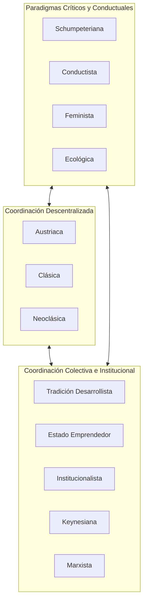

# Marco Epistemológico y Fundamentos Teóricos
## La Economía como Mosaico Pluralista y Alquimia Conceptual

---

## 1. Introducción y Tesis Central

El debate contemporáneo sobre política económica suele presentarse a la opinión pública como una disciplina técnica unívoca, en la que existen soluciones "óptimas" universales dictadas por leyes naturales incuestionables. Esta concepción tecnocrática oculta un hecho epistemológico fundamental: **la ciencia económica no es un cuerpo homogéneo de verdades cerradas, sino un mosaico histórico de tradiciones analíticas en pugna, cada una portadora de supuestos antropológicos, prioridades normativas y límites metodológicos particulares**.

**El Bar Económico: Elixires de la Razón** se concibe como un artefacto pedagógico y un ensayo interactivo diseñado para desmontar el monismo dogmático. Su premisa intelectual articula dos pilares de la filosofía política y metodológica del siglo XX y XXI:
1. **La taxonomía cualitativa y pluralista de Ha-Joon Chang** (*Economics: The User's Guide*, 2014).
2. **La dialéctica entre el Erizo y el Zorro postulada por Isaiah Berlin** (*The Hedgehog and the Fox*, 1953; *Two Concepts of Liberty*, 1958).

A través de la metáfora inmersiva de un bar alquímico (*Carbon Speakeasy*), el usuario no es un espectador pasivo de abstracciones estadísticas, sino un mezclador de elixires ideológicos que confronta la consistencia de sus intuiciones y los efectos colaterales de cada cóctel de política pública.

---

## 2. La Taxonomía Pluralista de Ha-Joon Chang

En su obra canónica de 2014, el economista heterodoxo Ha-Joon Chang desafía la hegemonía de la síntesis neoclásica proponiendo que ninguna escuela de pensamiento posee el monopolio de la explicación económica. Para Chang:
* El **marxismo** comprende como ninguna otra tradición las relaciones asimétricas de poder y la distribución de la plusvalía entre clases sociales, pero suele subestimar los mecanismos de incentivos descentralizados.
* La **escuela austriaca** destaca por su defensa del cálculo económico y el rol dinámico del empresario en condiciones de incertidumbre radical, pero ignora las fallas de coordinación macroeconómica y las desigualdades estructurales de partida.
* La **economía institucional** y la **tradición desarrollista** explican por qué los mercados no nacen espontáneamente, sino que son artefactos construidos y sostenidos por leyes, burocracias y capacidades estatales acumuladas.

El Bar Económico adopta las **12 escuelas identificadas por Chang**, elevándolas a la condición de "destilados puros" en la estantería del boticario:



---

## 3. El Dilema de Berlin: Erizos y Zorros en el Juicio Político

El filósofo Isaiah Berlin rescató un fragmento del poeta griego Arquíloco que sentó las bases de su célebre ensayo:
> *"Muchas cosas sabe el zorro, pero el erizo sabe una gran cosa."*

Berlin clasificó a los pensadores en dos temperamentos cognitivos irreconciliables:
* **Erizos (Monismo Axiológico):** Relacionan todo con una visión central única, un principio universal orientador y excluyente bajo el cual todo fenómeno humano puede y debe ser subordinado.
* **Zorros (Pluralismo de Valores):** Persiguen muchos fines, a menudo inconexos y contradictorios, reconociendo que los valores humanos supremos (libertad, justicia, igualdad, eficiencia) chocan entre sí y no admiten una solución aritmética perfecta.

### Aplicación al Bar Económico
El motor del simulador evalúa en qué medida el usuario opera como un Erizo (atribuyendo toda crisis a un solo culpable: el Estado interventor o la codicia corporativa) o como un Zorro (reconociendo equilibrios contingentes y trade-offs institucionales irreductibles).

```
                 Monismo Teórico (Erizo)
                          ▲
                          │
         Erizo Doctrinal  │  Erizo Híbrido
        (Dogma Único)     │  (Monismo Ecléctico)
                          │
  ◄───────────────────────┼───────────────────────► Enfoque
  Deductivo/Abstracto     │     Inductivo/Práctico
                          │
         Zorro Sistémico  │  Zorro Operativo
        (Pluralismo Ético)│  (Pragmatismo Radical)
                          │
                          ▼
                 Pluralismo Teórico (Zorro)
```

---

## 4. La Metáfora Mixológica: Dimensiones Organolépticas y Físicas

La metáfora de la coctelería conceptual no es un mero adorno estético; actúa como un modelo heurístico con correspondencias analíticas estrictas:

| Dimensión Coctelera | Concepto Económico Real | Rango y Escala | Justificación Teórica |
| :--- | :--- | :--- | :--- |
| **Graduación Alcohólica (ABV)** | Rigidez Dogmática / Pureza Metodológica | $0\% - 100\%$ | Mide el grado de intransigencia deductiva de la escuela (ej. Austriaca y Marxista presentan elevado ABV). |
| **Acidez de la Solución (pH)** | Grado de Intervención Pública | $1.0 - 14.0$ | **pH Ácido (< 7.0):** Fuerte dirección pública (Marxismo, Desarrollismo).<br>**pH Alcalino (> 7.0):** Laissez-faire y desregulación (Neoclásica, Austriaca). |
| **Notas Organolépticas** | Supuesto Antropológico y Tono Epistémico | Descriptivo | Captura sensorialmente la textura del modelo del mundo (ej. Neoclásica: aséptica y matemática; Feminista: afectiva y comunitaria). |
| **Toxicidad Colateral** | Externalidades Sistémicas y Fallas de Política | Síntomas Clínicos | Patologías desencadenadas cuando la escuela se aplica de forma monocorde (inflación crónica, burocratización asfixiante, colapso ecológico). |

---

## 5. El Ecosistema Educativo de la Ruta del Pensamiento Crítico

El Bar Económico forma parte de una secuencia pedagógica integral de cinco aplicaciones interactivas desarrolladas por William Camilo Artunduaga (`@willkwolf`), orientadas a democratizar la deliberación informada sobre economía política:


1. **Paso 1 (Comprender):** Mapeo de escuelas y sus postulados fundamentales.
2. **Paso 2 (Mezclar - Este artefacto):** Hibridación de cócteles, trade-offs y evaluación bayesiana de coherencia cognitiva.
3. **Paso 3 (Contrastar):** Discusión de los límites de la libertad negativa y la autodeterminación colectiva según Isaiah Berlin.
4. **Paso 4 (Escalar):** Asimetrías de ingresos a escala internacional y dinámicas de globalización.
5. **Paso 5 (Aterrizar):** Evidencia empírica sobre distribución del ingreso y brechas territoriales con datos del coeficiente de Palma.

---

## 6. Referencias Bibliográficas Fundacionales

* **Berlin, I.** (1953). *The Hedgehog and the Fox: An Essay on Tolstoy's View of History*. London: Weidenfeld & Nicolson.
* **Berlin, I.** (1958). *Two Concepts of Liberty*. Oxford: Clarendon Press.
* **Chang, H.-J.** (2014). *Economics: The User's Guide*. London: Penguin Books.
* **Hayek, F. A.** (1945). The Use of Knowledge in Society. *American Economic Review*, 35(4), 519–530.
* **Keynes, J. M.** (1936). *The General Theory of Employment, Interest and Money*. London: Macmillan.
* **Mazzucato, M.** (2013). *The Entrepreneurial State: Debunking Public vs. Private Sector Myths*. London: Anthem Press.
* **Raworth, K.** (2017). *Doughnut Economics: Seven Ways to Think Like a 21st-Century Economist*. White River Junction: Chelsea Green Publishing.
* **Schumpeter, J. A.** (1942). *Capitalism, Socialism and Democracy*. New York: Harper & Brothers.
