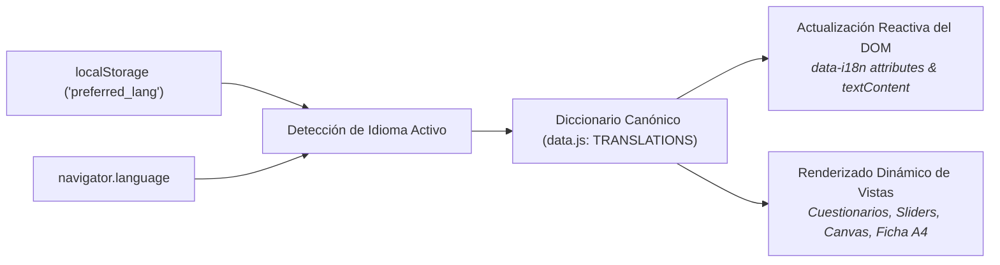

# Contrato de Gobernanza de Internacionalización (i18n)
## Política de Cero Fugas Lingüísticas y Paridad Semántica Dual (ES/EN)

---

## 1. Principio Fundamental de Paridad

**El Bar Económico** es un artefacto de divulgación y pedagogía cívica con vocación internacional. Toda funcionalidad, pantalla, pregunta, opción de respuesta, glosario contextual, ficha de cata descargable y mensaje de difusión social debe ofrecer una **experiencia nativa bilingüe (Español e Inglés)** de extremo a extremo, con paridad estructural estricta.

---

## 2. Arquitectura del Motor Reactivo de Traducción

El sistema opera bajo un motor nativo y ligero en cliente sin librerías externas de compilación:



### Mecanismo de Conmutación Reactiva
1. **Atributos Declarativos:** Los elementos estáticos del HTML se marcan con el atributo `data-i18n="clave.subclave"`.
2. **Actualización en Caliente:** Al invocar `setLanguage(lang)`, el motor actualiza inmediatamente los textos del DOM sin recargar la página, preservando el estado de progreso del test.
3. **Persistencia Local:** La preferencia se almacena en `localStorage.getItem("preferred_lang")`, con fallback automático al idioma del navegador (`navigator.language`).

---

## 3. Matriz de Claves y Paridad Obligatoria

Toda adición o modificación de contenido en `data.js` debe mantener simetría idéntica entre los dos bloques:

```
TRANSLATIONS
 ├── es (Español)
 │    ├── ui (Cadenas de navegación, botones, títulos, modales)
 │    ├── escuelas (12 escuelas de pensamiento)
 │    ├── cocteles (8 cócteles doctrinales)
 │    ├── problemas (6 dossiers de crisis de boticario)
 │    ├── preguntas (12 preguntas con 4 opciones o sliders)
 │    ├── perfiles_cognitivos (4 arquetipos de Berlin)
 │    ├── perfiles_cuadrantes (4 cuadrantes espaciales)
 │    ├── perfiles_concentracion (3 rangos de HHI)
 │    └── perfiles_consistencia (3 rangos de ICC)
 │
 └── en (Inglés)
      └── [Espejo exacto de claves y subestructuras]
```

---

## 4. Política de Cero Fugas y Pruebas Automatizadas

Se define como **fuga lingüística (*leak*)** cualquiera de los siguientes defectos en modo inglés:
1. Aparición de caracteres con tildes propias del español (`á`, `é`, `í`, `ó`, `ú`, `ñ`, `¿`, `¡`) en cadenas de interfaz.
2. Nombres de escuelas en español sin traducir (ej. mostrar *"Tradición Desarrollista"* en lugar de *"Developmental Tradition"*).
3. Claves ausentes que provoquen la visualización de la clave en bruto (ej. `[ui.btnNext]`) o valores `undefined`.

### Salvaguarda en Pruebas E2E de Playwright
La suite en `tests/e2e/diagnostic-flow.spec.js` incluye una prueba dedicada:
* `Full end-to-end English diagnostic journey generates a complete English report with zero Spanish leaks`
Esta prueba recorre el flujo completo desde el onboarding hasta la pantalla de resultados en inglés y valida mediante expresiones regulares que el DOM resultante carezca por completo de vocabulario o signos de puntuación propios del español.

---

## 5. Glosario Contextual Bilingüe (`GLOSSARY`)

El diccionario de términos técnicos en `data.js` se rige por las siguientes pautas:
* **Cobertura Mínima:** Todos los conceptos complejos presentes en las 12 preguntas del test (ej. *plusvalor*, *demanda agregada*, *destrucción creativa*, *nudging*, *Homo Economicus*) deben estar definidos en ambos idiomas.
* **Extensión Máxima:** Las definiciones deben formularse en un máximo de **180 caracteres** para evitar que los tooltips desborden en pantallas móviles de 320px de ancho.
* **Legibilidad:** Redacción clara, pedagógica y libre de jerga circular incomprensible para un ciudadano no economista.
